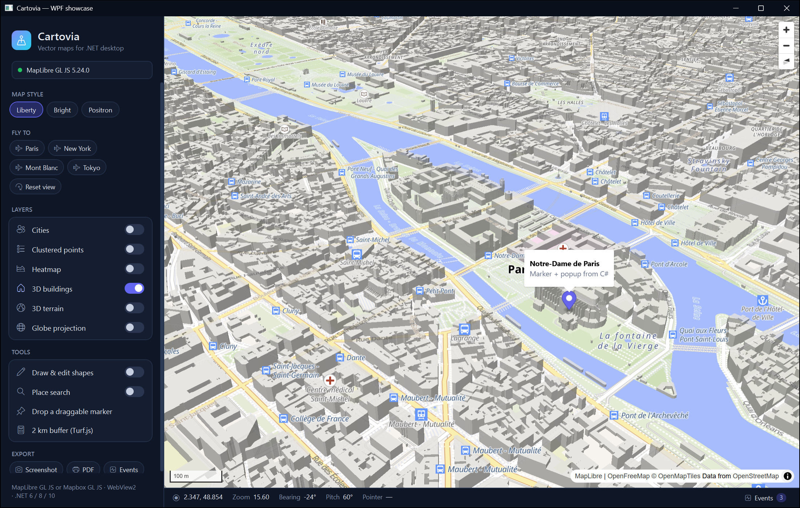

<div align="center">

# Cartovia

**Modern vector maps for .NET desktop apps — WPF and Windows Forms**

MapLibre GL JS (open source, no account needed) or Mapbox GL JS · WebView2 · .NET 6 / 8 / 10

[](https://github.com/nestebe/Cartovia/actions/workflows/ci.yml)
[](LICENSE)


**English** · [Français](README.fr.md)



</div>

Cartovia hosts a WebGL vector map engine in WebView2 and exposes it through a **strongly-typed C# API**: layers,
styles, expressions, markers, popups, controls, plugins and events raised in .NET.
Out of the box it works **without any account or key**, using MapLibre GL JS and the free OpenFreeMap basemaps;
Mapbox GL JS is available as an option, with the same API.

## Documentation

Guides with examples for every feature live in [**docs/**](docs/README.md):
[Getting started](docs/getting-started.md) ·
[WPF](docs/wpf.md) · [WinForms](docs/winforms.md) ·
[Map & camera](docs/map-and-camera.md) ·
[Sources & layers](docs/sources-and-layers.md) ·
[Expressions](docs/expressions.md) ·
[Events](docs/events.md) ·
[Markers, popups & controls](docs/annotations-and-controls.md) ·
[Queries & feature state](docs/queries-and-feature-state.md) ·
[Plugins](docs/plugins.md) ·
[Extensions](docs/extensions.md) ·
[GeoJSON](docs/geojson.md) ·
[Mapbox services](docs/mapbox-services.md) ·
[Advanced topics](docs/advanced.md)

## Packages

| Package | Purpose |
|---|---|
| `Cartovia.Wpf` | WPF `MapView` control (bindable properties, two-way camera, MVVM commands) |
| `Cartovia.WinForms` | Windows Forms `MapView` control |
| `Cartovia.Core` | UI-agnostic typed API: camera, sources, **every style layer and property**, expressions, annotations, plugins, events, GeoJSON |
| `Cartovia.WebView2` | Shared WebView2 host (embedded page, messaging, navigation, permissions, PNG capture, PDF export) |
| `Cartovia.Mapbox.Services` | Optional Mapbox extension: REST clients for Geocoding, Search Box, Directions, Matrix, Isochrone, Optimization, Map Matching, Static Images, Tilequery |

## Quick start (WPF)

```bash
dotnet add package Cartovia.Wpf
```

```xml
<Window xmlns:carto="clr-namespace:Cartovia.Wpf;assembly=Cartovia.Wpf">
    <carto:MapView x:Name="MapView"
                   MapStyle="https://tiles.openfreemap.org/styles/liberty"
                   Center="2.35, 48.85" Zoom="12" Pitch="45" />
</Window>
```

```csharp
var map = MapView.Map;
map.Loaded += async (_, _) =>
{
    await map.AddSourceAsync(new GeoJsonSource("cities", cities) { GenerateId = true });
    await map.AddLayerAsync(new CircleLayer("cities", "cities")
    {
        CircleRadius = Expr.InterpolateZoom((5, 3), (14, 12)),
        CircleColor = Expr.Match(Expr.Get("type"), "#64748b", ("capital", "#dc2626")),
    });
    await map.ShowPopupOnClickAsync("cities", "<b>{name}</b>");
    await map.AddPluginAsync(new DrawPlugin());
};
map.OnLayer("cities", LayerEvent.Click, (_, e) => Debug.WriteLine(e.Feature?.GetProperty<string>("name")));
```

With Mapbox: `Engine="Mapbox" AccessToken="pk.…" MapStyle="mapbox://styles/mapbox/standard"`.

## Features

- **Two engines, one API**: MapLibre GL JS v5 (default, BSD license) and Mapbox GL JS v3 (Standard style, 3D lights,
  snow/rain, featureset interactions). Default versions live in `EngineDefaults` and can be overridden.
- **Layers**: 15 layer types and 237 paint/layout properties generated from the official style specifications
  (`tools/generate_style_spec.py`); XML docs state the supporting engine, default value, range and units.
- **Expressions**: typed helpers (`Interpolate`, `Match`, `Case`, `Step`, `Let`, `Format`…), all 102 operators of the spec,
  and C# operators (`Expr.Get("v") * 2`).
- **Sources**: GeoJSON (clustering, `updateData`), vector, raster, raster-dem, raster-array, image, video, `RawSource`.
- **Camera**: `FlyToAsync` / `EaseToAsync` / `FitBoundsAsync` that complete when the animation ends, padding, globe.
- **Events**: 40+ typed events (mouse, camera, data, errors), `On("name")` for any other one, per-layer events,
  marker, popup, control and plugin events; high-frequency events are throttled.
- **Annotations and controls**: markers (custom HTML, drag, popup), popups, navigation, scale, fullscreen, geolocation,
  attribution, terrain, globe, and `HtmlControl` (an HTML control whose commands are raised in .NET).
- **Plugins**: Draw (drawing and editing), Geocoder (Nominatim, a .NET provider, or Mapbox), Directions (Mapbox), Turf.js;
  `ScriptPlugin` / `MapPlugin` to write your own (commands, events, JS → .NET calls).
- **Extensions**: clusters, heatmap, 3D buildings, 3D terrain (keyless AWS Terrain Tiles with MapLibre), feature-state
  hover and selection, click popups from a template, automatic GeoJSON layers, WMS/XYZ raster overlays.
- **Robustness**: calls are queued until the map is loaded, timeouts, typed exceptions, user layers restored after a
  style change, automatic reload after a renderer crash, links opened in the default browser, clear message when the
  WebView2 runtime is missing.
- **Escape hatches**: `InvokeAsync("method", …)` to call any engine method, `EvalAsync(js)`, `RegisterHostCallback`
  (call .NET from JavaScript).
- **Export**: PNG/JPEG capture and PDF.

## Basemaps and services

| Need | Without an account | With Mapbox |
|---|---|---|
| Basemaps | OpenFreeMap (`MapStyles.OpenFreeMap*`), or any MapLibre style (MapTiler, Stadia, your own tiles…) | `mapbox://` styles including Standard |
| Place search | Nominatim / your .NET provider | Mapbox Geocoding |
| 3D terrain | AWS Terrain Tiles | Mapbox Terrain DEM |
| Routing | Your own service (GeoJSON line) | Directions plugin, `Cartovia.Mapbox.Services` |

OpenFreeMap and Nominatim are free but come without a service-level guarantee; for high-traffic apps, use a commercial
provider or host your own tiles.

## Offline / local assets

Engines and plugins are loaded from their official CDNs by default. To ship them with your app:

```powershell
./tools/download-offline-assets.ps1 -Destination ./assets
```

```csharp
mapView.HostOptions.LocalAssetsFolder = @"C:\MyApp\assets";
mapView.Options.EngineScriptUrl = WebView2HostOptions.LocalAssetsBaseUrl + "maplibre-gl.js";
mapView.Options.EngineStylesheetUrl = WebView2HostOptions.LocalAssetsBaseUrl + "maplibre-gl.css";
```

## Good to know

- **WebView2 runtime**: built into Windows 11 and nearly universal on Windows 10; otherwise the control shows a download link.
- **WPF "airspace"**: the classic WebView2 is a native window; set `UseCompositionControl = true` to draw WPF content over the map.
- **Mapbox**: an access token is required and Mapbox bills per map load; a URL-restricted token must allow `https://cartovia.local`.
- **.NET 6** is out of Microsoft support but remains a compiled target; tests run on .NET 8 and .NET 10.

## Development

```bash
dotnet build Cartovia.sln
dotnet test Cartovia.sln
dotnet run --project samples/Cartovia.Samples.Wpf
```

The samples use MapLibre + OpenFreeMap, or Mapbox when the `MAPBOX_ACCESS_TOKEN` environment variable is set.

Regenerate the layers for a new version of the style specifications:

```bash
python tools/generate_style_spec.py --mapbox-version 14.34.2 --maplibre-version 26.5.1
```

## Publishing to NuGet

- Version: `VersionPrefix` in `Directory.Build.props` (or `-p:Version=x.y.z`).
- Locally: `dotnet pack Cartovia.sln -c Release -o artifacts`.
- CI: `.github/workflows/ci.yml` builds and tests on every push. A `v1.2.3` tag packs the libraries (`.snupkg` symbols,
  SourceLink), publishes them to **GitHub Packages** (no secret needed), to **nuget.org** when the `NUGET_API_KEY`
  secret is set, and creates a GitHub release with the packages attached.

Installing from GitHub Packages requires a personal access token with the `read:packages` scope:

```bash
dotnet nuget add source https://nuget.pkg.github.com/nestebe/index.json --name cartovia-github --username YOUR_GITHUB_USER --password YOUR_TOKEN
```

## License

MIT. MapLibre GL JS is BSD-3-Clause licensed; Mapbox GL JS, its plugins and the Mapbox services are subject to the
[Mapbox Terms of Service](https://www.mapbox.com/legal/tos). Cartovia is not affiliated with MapLibre or Mapbox.
