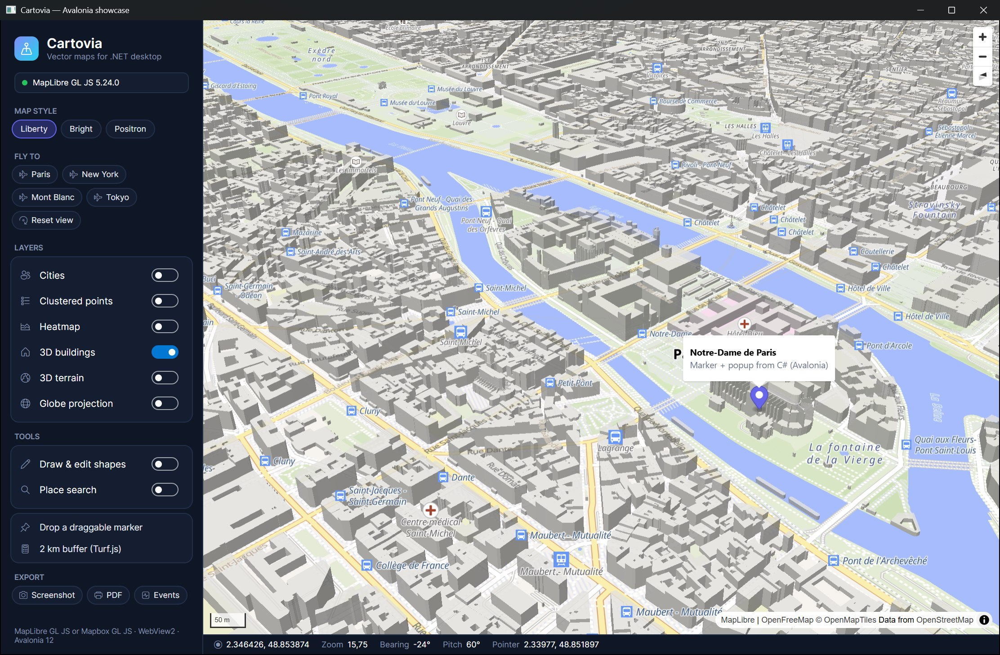

# Avalonia control

`Cartovia.Avalonia.MapView` hosts the map in WebView2 through Avalonia's `NativeControlHost`.
The full API is on `MapView.Map` (a `CartoviaMap`), exactly like the WPF and Windows Forms controls.



```bash
dotnet add package Cartovia.Avalonia
```

Requirements: **Avalonia 12**, `net8.0-windows` or `net10.0-windows`, Windows 10/11 with the WebView2 runtime.
The UI thread must be STA (the default `[STAThread] Main` of Avalonia templates).

## XAML

```xml
<Window xmlns="https://github.com/avaloniaui"
        xmlns:carto="clr-namespace:Cartovia.Avalonia;assembly=Cartovia.Avalonia">
    <carto:MapView x:Name="MapView"
                   MapStyle="https://tiles.openfreemap.org/styles/liberty"
                   Center="{Binding Center}" Zoom="{Binding Zoom}"
                   Pitch="45"
                   ClickCommand="{Binding MapClickCommand}"
                   LoadedCommand="{Binding MapLoadedCommand}" />
</Window>
```

Literal values work too: `Center="2.35, 48.85"`.

## Properties

| Property | Type | Notes |
|---|---|---|
| `Engine` | `MapEngine` | `MapLibre` (default) or `Mapbox`. Changing it after load recreates the map. |
| `AccessToken` | `string?` | Mapbox token. Changing it after load recreates the map. |
| `MapStyle` | `string?` | Style URL. Changing it calls `SetStyleAsync` (your layers are restored). |
| `Center` | `LngLat` | **Two-way** by default. |
| `Zoom`, `Bearing`, `Pitch` | `double` | **Two-way** by default. |
| `IsMapLoaded` | `bool` | Read-only (direct property). |
| `ClickCommand` | `ICommand?` | Executed on map clicks with the `MapMouseEventArgs`. |
| `LoadedCommand` | `ICommand?` | Executed once the map is loaded with the `CartoviaMap`. |

`Options` (`MapOptions`) and `HostOptions` (`WebView2HostOptions`) must be configured before the control is attached
to a window, e.g. in the window constructor after `InitializeComponent()`:

```csharp
MapView.Options.InitialControls.Add(new NavigationControl { VisualizePitch = true });
MapView.HostOptions.EnableDevTools = true;

MapView.Map.Loaded += async (_, _) =>
    await MapView.Map.AddMarkerAsync(new LngLat(2.35, 48.85), color: "#6366F1", popupHtml: "<b>Paris</b>");
```

## Events and export

| Member | Notes |
|---|---|
| `MapLoaded`, `CameraChanged` | `MapCameraEventArgs` |
| `InitializationFailed` | Runtime missing, non-Windows OS… |
| `SaveScreenshotAsync`, `CaptureAsync`, `PrintToPdfAsync`, `OpenDevTools` | Same as WPF |
| `Dispose()` | Called automatically when the window closes |

Every other event is on `MapView.Map` (see [Events](events.md)).

## Things to know

- **Native child window**: like any `NativeControlHost`, Avalonia content cannot be drawn over the map. Put overlays
  next to the map, or use map-side overlays: markers, popups and [HTML controls](annotations-and-controls.md#custom-html-controls).
- **Rendering**: Windows' native occlusion detection can mistake a WebView hosted under Avalonia's composition window
  for hidden and stop rendering. The control therefore starts WebView2 with
  `MapView.DefaultBrowserArguments` (`--disable-features=CalculateNativeWinOcclusion --disable-backgrounding-occluded-windows`),
  merged with your `HostOptions.AdditionalBrowserArguments`.
- **Moving the control**: when the control leaves the visual tree (tabs, re-templating) the WebView is kept alive in a
  hidden window and re-attached when it comes back.
- **Platforms**: Windows only for now (WebView2). On other platforms `InitializationFailed` is raised.
