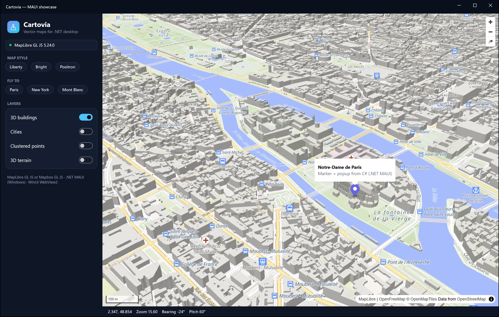

# .NET MAUI control

`Cartovia.Maui.MapView` brings the map to .NET MAUI apps. On **Windows** it runs in the WinUI `WebView2`
(through `Cartovia.WinUI`); on Android, iOS and Mac Catalyst it displays a placeholder so that multi-platform apps
still build and run. The full API is on `MapView.Map` (a `CartoviaMap`).



```bash
dotnet add package Cartovia.Maui
```

Requirements: .NET MAUI 10 (`net10.0-windows10.0.19041.0` for the map; any other MAUI target gets the placeholder).

## Registration

```csharp
public static MauiApp CreateMauiApp()
    => MauiApp.CreateBuilder()
        .UseMauiApp<App>()
        .UseCartovia()          // registers the Windows handler
        .Build();
```

## XAML

```xml
<ContentPage xmlns:carto="clr-namespace:Cartovia.Maui;assembly=Cartovia.Maui">
    <carto:MapView x:Name="MapView"
                   MapStyle="https://tiles.openfreemap.org/styles/liberty"
                   Center="2.35, 48.85" Zoom="12" Pitch="45"
                   ClickCommand="{Binding MapClickCommand}"
                   LoadedCommand="{Binding MapLoadedCommand}" />
</ContentPage>
```

`Center` accepts `"longitude, latitude"` in XAML (the `LngLat` type converter) and binds to a `LngLat` property.

## Bindable properties

| Property | Type | Notes |
|---|---|---|
| `Engine` | `MapEngine` | `MapLibre` (default) or `Mapbox`. Changing it after load recreates the map. |
| `AccessToken` | `string?` | Mapbox token. |
| `MapStyle` | `string?` | Style URL. Changing it calls `SetStyleAsync` (your layers are restored). |
| `Center` | `LngLat` | **Two-way** by default. |
| `Zoom`, `Bearing`, `Pitch` | `double` | **Two-way** by default. |
| `IsMapLoaded` | `bool` | Read-only. |
| `ClickCommand` | `ICommand?` | Executed on map clicks with the `MapMouseEventArgs`. |
| `LoadedCommand` | `ICommand?` | Executed once the map is loaded with the `CartoviaMap`. |

Configure `MapView.Options` (and `MapView.HostOptions` on Windows) before the page is displayed:

```csharp
MapView.Options.InitialControls.Add(new NavigationControl());
#if WINDOWS
MapView.HostOptions.EnableDevTools = true;
#endif
MapView.MapLoaded += async (_, _) => await MapView.Map.AddGeoJsonAsync("zones", zones, "#e11d48");
```

## Events and export

| Member | Notes |
|---|---|
| `MapLoaded`, `CameraChanged` | `MapCameraEventArgs` |
| `InitializationFailed` | `MapInitializationFailedEventArgs` (`IsRuntimeMissing`) |
| `SaveScreenshotAsync`, `CaptureAsync`, `PrintToPdfAsync`, `OpenDevTools` | Windows only (`PlatformNotSupportedException` elsewhere) |
| `Dispose()` | Releases the WebView2 |

## Things to know

- **Other platforms**: the control shows "The Cartovia map requires Windows." and map calls fail with a
  `MapInitializationException`; `Map.Error` is raised with `IsFatal = true`.
- **Windows App SDK**: `Cartovia.WinUI` targets the same Windows App SDK version as MAUI 10, so no version conflict.
- **Namespaces**: MAUI's implicit usings include `Microsoft.Maui.Graphics.Point` and `Microsoft.Maui.Controls.Style`;
  qualify `Cartovia.GeoJson.Point` / `Cartovia.Style` types when both are in scope.
