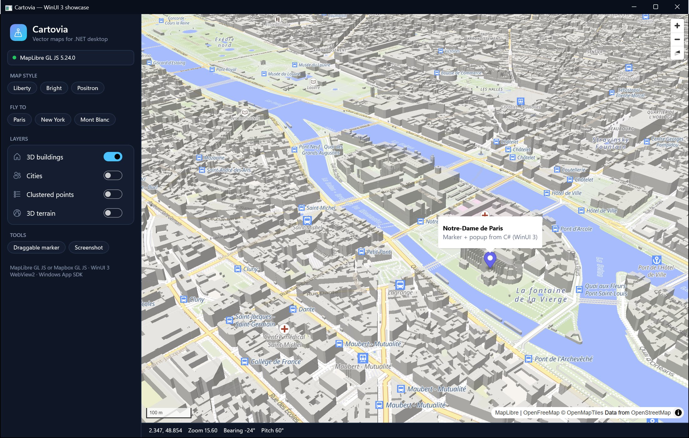

# WinUI 3 control

`Cartovia.WinUI.MapView` hosts the map in the WinUI 3 `WebView2` (Windows App SDK). The full API is on
`MapView.Map` (a `CartoviaMap`), exactly like the WPF, Windows Forms and Avalonia controls.



```bash
dotnet add package Cartovia.WinUI
```

Requirements: Windows App SDK **1.8 or later** (the version used by .NET MAUI 10; newer versions such as 2.x work),
`net8.0-windows10.0.19041.0` or `net10.0-windows10.0.19041.0`, Windows 10 1809+ with the WebView2 runtime.
Packaged and unpackaged apps are supported.

## XAML

```xml
<Page xmlns:carto="using:Cartovia.WinUI">
    <carto:MapView x:Name="MapView"
                   MapStyle="https://tiles.openfreemap.org/styles/liberty"
                   Longitude="2.35" Latitude="48.85" Zoom="12" Pitch="45"
                   ClickCommand="{x:Bind ViewModel.MapClickCommand}" />
</Page>
```

WinUI XAML has no type converters for custom structs, so the center is exposed twice and kept in sync:
`Longitude` / `Latitude` (doubles, XAML-friendly) and `Center` (`LngLat`, for code).

```csharp
MapView.Center = new LngLat(4.8357, 45.7640);   // moves the map, updates Longitude / Latitude
```

## Properties

| Property | Type | Notes |
|---|---|---|
| `Engine` | `MapEngine` | `MapLibre` (default) or `Mapbox`. Changing it after load recreates the map. |
| `AccessToken` | `string?` | Mapbox token. Changing it after load recreates the map. |
| `MapStyle` | `string?` | Style URL. Changing it calls `SetStyleAsync` (your layers are restored). |
| `Center` | `LngLat` | Code only. Updated at the end of every camera move. |
| `Longitude`, `Latitude` | `double` | XAML-friendly center. |
| `Zoom`, `Bearing`, `Pitch` | `double` | Updated when the map moves; bind with `Mode=TwoWay` to follow the map. |
| `IsMapLoaded` | `bool` | Read-only. |
| `ClickCommand` | `ICommand?` | Executed on map clicks with the `MapMouseEventArgs`. |
| `LoadedCommand` | `ICommand?` | Executed once the map is loaded with the `CartoviaMap`. |

`Options` (`MapOptions`) and `HostOptions` (`WinUIHostOptions`) must be configured before the control is loaded:

```csharp
MapView.Options.InitialControls.Add(new NavigationControl { VisualizePitch = true });
MapView.HostOptions.EnableDevTools = true;
MapView.HostOptions.AllowGeolocation = true;

MapView.Map.Loaded += async (_, _) =>
    await MapView.Map.AddMarkerAsync(new LngLat(2.35, 48.85), color: "#6366F1", popupHtml: "<b>Paris</b>");
```

`WinUIHostOptions`: `UserDataFolder` (default `%LOCALAPPDATA%\<app>\Cartovia\WebView2`), `BrowserExecutableFolder`,
`AdditionalBrowserArguments`, `EnableDevTools`, `AllowGeolocation`, `EnableContextMenu`, `OpenLinksInBrowser`,
`LocalAssetsFolder` (served at `https://assets.cartovia.local/`).

## Events and export

| Member | Notes |
|---|---|
| `MapLoaded`, `CameraChanged` | `MapCameraEventArgs` |
| `InitializationFailed` | `WinUIHostErrorEventArgs` (`IsRuntimeMissing` when WebView2 is not installed) |
| `SaveScreenshotAsync`, `CaptureAsync`, `PrintToPdfAsync`, `OpenDevTools` | Same as WPF |
| `Dispose()` | Closes the WebView2 |

Every other event is on `MapView.Map` (see [Events](events.md)).

## Things to know

- **Separate host**: WinUI uses the WinRT projection of WebView2, so this package does not depend on
  `Cartovia.WebView2`; it ships its own host (`WinUIMapHost`) with the same behaviour (embedded page, links opened in
  the browser, permissions, reload after a renderer crash, screenshots, PDF).
- **Overlays**: the WinUI `WebView2` is composited by XAML, so WinUI content can be drawn over the map.
- **Building your own control**: `WinUIMapController` owns the map and the host and initializes any WinUI `WebView2`
  (it is what the MAUI handler uses).
